# Plano Diretor — Nova Avaliação de Riscos (PGR / AIHA / eSocial)

## 1. Visão Geral e Diagnóstico Atual

Atualmente, o painel conta com uma aba denominada **"Matriz de Risco (GHE)"**, porém ela atua primordialmente como um painel analítico de leitura com KPIs e gráficos estáticos. Ao interagir com itens da lista de riscos críticos, o usuário é redirecionado para a aba *Efetivo > sub-aba GHE*, onde a interface de edição é linear e não contempla a riqueza de dados exigida por um Inventário de Riscos profissional de SST.

Em contrapartida, sistemas corporativos como o **SGG** possuem uma estrutura de tela dividida em:
- Cabeçalho do Setor/GHE (Datas de vigência, cargos vinculados e alertas);
- Abas/Chips de riscos por setor;
- Avaliação matricial (AIHA / Probabilidade × Efeito);
- Detalhamento multifacetado (Avaliação Quali/Quanti, EPIs com CA, EPCs, Medidas de Controle, Conclusões de Laudos e Danos à Saúde).

### Objetivo
Transformar a aba atual no módulo definitivo de **"Avaliação de Riscos & Inventário PGR"**, unificando cadastro, edição, cálculo AIHA em tempo real, visualização de cargos/efetivo exposto e impressão do inventário oficial, **superando a ergonomia e usabilidade do SGG**.

---

## 2. Comparativo: SGG vs. Nossa Solução Proposta

| Recurso | Modelo SGG (Print) | Solução Proposta no App Checklist |
| :--- | :--- | :--- |
| **Arquitetura de Navegação** | Telas estáticas com recarregamento e caixas separadas | Navegação reativa em aba única (`/dashboard/`), sem redirecionamento para o Efetivo |
| **Seleção de Setor / GHE** | Select simples de setor | Seletor com busca rápida de GHE + visualização imediata do total de colaboradores ativos expostos |
| **Cargos Vinculados** | Textbox simples somente-leitura | Card dinâmico com tabela de Cargos, CBO, efetivo ativo e descrição das atividades |
| **Abas de Riscos** | Abas horizontais antigas com setas de rolagem lentas | Chips interativos com badges coloridos pelo nível de gravidade AIHA (Trivial a Muito Alto) |
| **Catálogo de Agentes** | Campo de texto com busca pop-up | Autocomplete inteligente com agentes pré-cadastrados (Físicos, Químicos, Biológicos, Ergonômicos, Acidentes) e **código da Tabela 24 do eSocial** |
| **Cálculo da Matriz** | Dropdowns de probabilidade e efeito com ícones de ajuda | Matriz AIHA interativa com matriz visual destacando o quadrante resultante em tempo real |
| **Fontes Geradoras** | Duas caixas com botões antiquados `<` e `>` | Tags/Chips modernos com inclusão rápida e histórico de fontes do setor |
| **EPIs e Medidas** | Campos de texto isolados | Vínculo com catálogo de EPIs do sistema, número de CA e status de atenuação |
| **Relatórios e Impressão** | Exportação padrão | Emissão do **Inventário Geral de Riscos do PGR** formatado e timbrado via `abrirDocumentoHtmlParaImpressao` (compatível com a Vercel) |

---

## 3. Arquitetura da Interface da Nova Avaliação de Riscos

```mermaid
flowchart TD
    A["Módulo: Avaliação de Riscos (Dashboard)"] --> B["Barra de Controle Superior"]
    B --> B1["Seletor de Setor / GHE (ex: GRUPO 01 - VIGILÂNCIA PATRIMONIAL)"]
    B --> B2["Datas de Vigência do Inventário (Início e Validade Trienal)"]
    B --> B3["Ações: Novo Grupo, Imprimir PGR, Exportar Excel, Recalcular AIHA"]

    A --> C["Painel Resumo do Setor"]
    C --> C1["Quadro de Cargos e CBOs vinculados"]
    C --> C2["Efetivo Exposto (Colaboradores ativos alocados)"]
    C --> C3["Alerta de Riscos Psicossociais / NR-01"]

    A --> D["Barra de Chips de Riscos Cadastrados"]
    D --> D1["[+ Novo Risco]"]
    D --> D2["Chip: Radiações não Ionizantes (Moderado)"]
    D --> D3["Chip: Ruído Contínuo (Alto)"]
    D --> D4["Chip: Postura em Pé (Baixo)"]

    A --> E["Área de Edição do Risco Ativo"]
    E --> E1["Dados do Agente (Tipo, Nome, eSocial, Código)"]
    E --> E2["Matriz AIHA (Probabilidade 1-5 x Efeito 1-5 -> Gravidade Instantânea)"]
    E --> E3["Fontes Geradoras e Tempo de Exposição"]
    E --> E4["Sub-abas Técnicas"]

    E4 --> F1["1. Avaliação (Qualitativa / Quantitativa e Limites de Tolerância)"]
    E4 --> F2["2. EPI(s) com CA e Eficácia"]
    E4 --> F3["3. EPC(s) Existentes e Recomendados"]
    E4 --> F4["4. Medidas de Controle e Treinamentos"]
    E4 --> F5["5. Conclusões e Laudos (Insalubridade, Periculosidade, GFIP)"]
    E4 --> F6["6. Perigos e Agravos à Saúde"]
```



---

## 4. Estrutura de Dados e Compatibilidade

A tabela central no Supabase continuará sendo `public.ghe_catalogo`, garantindo **100% de compatibilidade retroativa** com as Ordens de Serviço (NR-01), Termos NR-10 e Matriz de EPI (NR-6):

```json
{
  "id": "GRUPO 01",
  "nome": "VIGILANCIA PATRIMONIAL",
  "data_inicio": "2024-07-16",
  "data_validade": "2027-07-16",
  "cargos": [
    {
      "cargo": "Vigia",
      "funcao": "Vigia",
      "cbo": "5174-20",
      "quantidade": 6,
      "descricao_atividade": "Vigilância e guarda patrimonial das instalações..."
    }
  ],
  "riscos": [
    {
      "id": "r_1710928374",
      "tipo_agente": "Físico",
      "agente": "Ruído contínuo ou intermitente",
      "esocial_codigo": "01.01.001",
      "matriz": "AIHA",
      "probabilidade": 3,
      "severidade": 4,
      "gravidade": 12,
      "gravidade_label": "Alto",
      "prioridade": "Prioridade 2 - Ação Programada em 30 dias",
      "fontes_geradoras": ["Tráfego de viaturas", "Grupo Gerador"],
      "tipo_tempo_exposicao": "Habitual e intermitente (8h diárias)",
      "avaliacao_tipo": "quantitativa",
      "trajetoria": "Propagação aérea",
      "medicao_valor": "82.4",
      "medicao_unidade": "dB(A)",
      "limite_tolerancia": "85.0 dB(A)",
      "nivel_acao": "80.0 dB(A)",
      "epis": [
        { "item": "Protetor Auditivo tipo Plug", "ca": "14470", "eficaz": true }
      ],
      "epcs": ["Enclausuramento acústico do gerador"],
      "medidas_controle": "Manutenção preventiva de motores e exames audiométricos anuais",
      "danos_saude": "Perda Auditiva Induzida por Ruído (PAIR), fadiga, estresse",
      "conclusoes": {
        "insalubridade": "Não enseja (atenuado por EPI)",
        "periculosidade": "Não enseja",
        "gfip_codigo": "01"
      }
    }
  ]
}
```

---

## 5. Roteiro de Execução e Fases

### Fase 1: Interface e Painel de Seleção (Substituição de Redirecionamentos)
- Renomear o item de menu para **"Avaliação de Riscos (AIHA)"**;
- Criar a toolbar de seleção de GHE/Setor na própria página `page-matrizrisco`;
- Exibir os dados do setor selecionado, vigência, colaboradores ativos alocados e relação de cargos/CBOs sem sair da tela;
- Eliminar o redirecionamento `irParaGheDaMatriz` que mandava o usuário para outra aba.

### Fase 2: Gestor de Riscos em Abas / Chips
- Renderizar os riscos do GHE em chips clicáveis no topo da área de edição, com botão `[+ Novo Risco]`;
- Badge dinâmico de cor em cada chip de acordo com a gravidade calculada;
- Botão rápido para duplicar risco entre setores similares ou remover risco.

### Fase 3: Formulário Especializado com Cálculo AIHA e Catálogo eSocial
- Formulário com seleção de Agente por Tipo (Físico, Químico, Biológico, Ergonômico, Acidentes);
- Sugestão automática de agentes com código do eSocial (Tabela 24);
- Seletores de Probabilidade e Severidade com as âncoras textuais completas da metodologia AIHA;
- Matriz visual interativa 5x5 destacando a célula ativa;
- Sub-abas organizadas: Avaliação (Quanti/Quali), EPIs (com CAs vinculados), EPCs, Medidas de Controle, Conclusões de Laudos e Danos à Saúde.

### Fase 4: Integração de Impressão e Sincronização
- Criação da rotina de impressão oficial do **Inventário de Riscos do PGR por Setor/GHE** com cabeçalho timbrado, assinaturas e tabela matricial;
- Sincronização automática com `ghe_catalogo` no Supabase e atualização dos KPIs globais.

---

> [!IMPORTANT]
> A implementação preservará integralmente a integridade dos dados existentes de todos os 27 grupos de GHE já cadastrados, permitindo que os riscos atuais ganhem imediatamente a nova visualização e possam ser enriquecidos sem perda cadastral.
